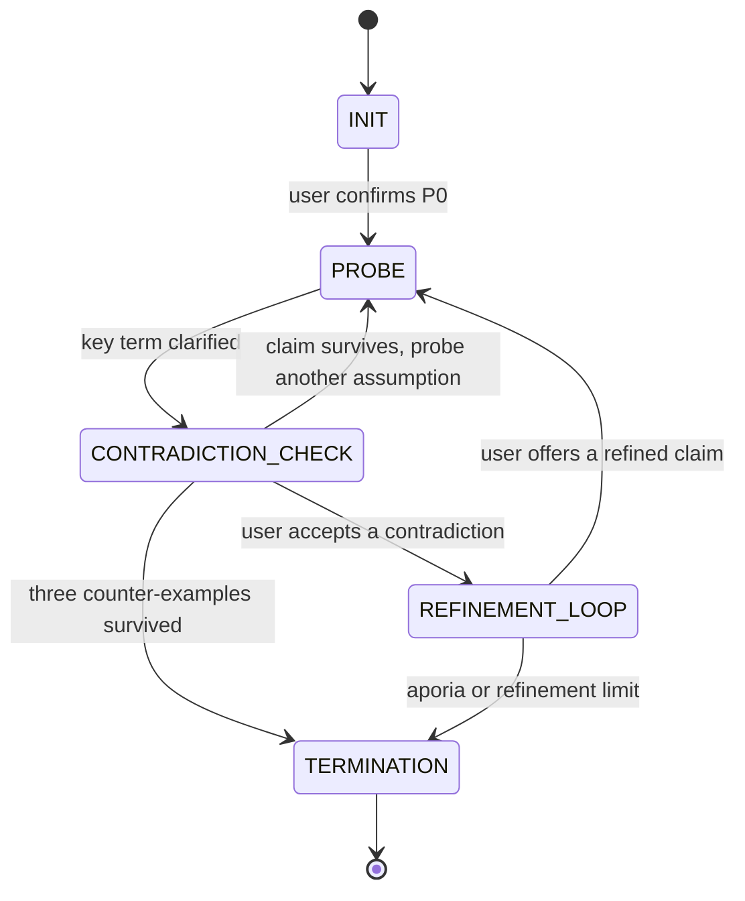

# Mission 01: Socratic Protocol Map (SAMPLE)

**Course:** Conversational AI (WS 2026/27) | **Squadron:** Squadron Goodfellow | **Role:** Protocol Specialist

> SAMPLE for the squad. Replace the explanations with your own analysis, but keep the headings and the table columns of sections 2.2 to 2.5, because the engine reads them. Save the final version as `02_Socratic_Protocol_Map.md`.

---

## Part 1: The Socratic State Machine

### 1.1 Overview

In Plato's *Euthyphro*, Socrates examines a claim by asking questions, offering counter-examples, and checking for contradictions, until the claim is refined or the interlocutor reaches **aporia** (an acknowledged impasse). The elenchus can be modelled as a state machine over a claim P_k:

- **P0** is the user's initial claim.
- **P_(k+1) = Refine(P_k, E)**, where E is a counter-example the user accepted.
- The loop ends when the claim survives enough counter-examples, when the user cannot refine consistently, or when a refinement limit is reached.

State names follow the instructor's starter engine and the Alignment Brief: `INIT`, `PROBE`, `CONTRADICTION_CHECK`, `REFINEMENT_LOOP`, `TERMINATION`.

### 1.2 State diagram



### 1.3 Transition table

| From | To | Condition |
|---|---|---|
| INIT | PROBE | The user confirms AURA's restatement of P0. |
| PROBE | CONTRADICTION_CHECK | A key term is clarified and an admission is recorded. |
| CONTRADICTION_CHECK | REFINEMENT_LOOP | The user accepts that the claim conflicts with a counter-example or with an earlier admission. |
| CONTRADICTION_CHECK | PROBE | The claim survives the counter-example and another assumption should be tested. |
| CONTRADICTION_CHECK | TERMINATION | The claim has survived three distinct counter-examples (`PROVISIONALLY_DEFENSIBLE`). |
| REFINEMENT_LOOP | PROBE | The user offers a refined claim P_(k+1). |
| REFINEMENT_LOOP | TERMINATION | The user cannot refine consistently (`APORIA`) or five refinements were attempted (`REFINEMENT_LIMIT`). |

---

## Part 2: JSON-RPC Protocol

Every state transition is sent as a JSON-RPC 2.0 message. Example (the engine produces messages of this shape):

```json
{"jsonrpc": "2.0", "method": "INJECT_COUNTEREXAMPLE",
 "params": {"state": "CONTRADICTION_CHECK", "reason": null, "turn": 3, "refinement": 0},
 "id": 3}
```

### 2.1 Message fields

| Field | Meaning |
|---|---|
| `method` | The message name for the state (table 2.2) or for the termination reason (table 2.3). |
| `params.state` | The state AURA entered. |
| `params.reason` | Termination reason, or `null` outside `TERMINATION`. |
| `params.turn` | Dialogue turn number. |
| `params.refinement` | Number of refinements so far (k in P_k). |
| `id` | Message counter, starting at 1. |

### 2.2 JSON-RPC Methods per State

| State | Method |
|---|---|
| INIT | PROMPT_PREMISE |
| PROBE | PROBE_SCOPE |
| CONTRADICTION_CHECK | INJECT_COUNTEREXAMPLE |
| REFINEMENT_LOOP | CONTRADICTION_TRIGGERED |
| TERMINATION | TERMINATE |

### 2.3 Termination Reasons

When the state is `TERMINATION`, the method depends on the reason:

| Reason | Method |
|---|---|
| PROVISIONALLY_DEFENSIBLE | CLAIM_DEFENSIBLE |
| APORIA | APORIA_REACHED |
| REFINEMENT_LIMIT | REFINEMENT_LIMIT_REACHED |

### 2.4 Error Codes

Codes use the JSON-RPC implementation-defined range (-32000 to -32099). The names of the first two rows match the termination reasons.

| Code | Name | Meaning |
|---|---|---|
| -32020 | APORIA | The user acknowledged conflicting claims and could not refine consistently. |
| -32030 | REFINEMENT_LIMIT | Five refinements were attempted without a stable claim. This is a practical stop, not philosophical aporia. |
| -32040 | LLM_PROVIDER_ERROR | The language-model API call failed (network error, rate limit, invalid key). |
| -32050 | INVALID_AURA_HEADER | AURA's reply did not start with a valid JSON header after one repair attempt. |

### 2.5 Stopping Rules

| Rule | Value |
|---|---|
| MAX_REFINEMENTS | 5 |
| COUNTEREXAMPLES_FOR_DEFENSIBLE | 3 |

`MAX_REFINEMENTS` is enforced by the engine as a safety limit. `COUNTEREXAMPLES_FOR_DEFENSIBLE` is enforced by AURA's prompt (see the Alignment Brief, section 3.1). Surviving three counter-examples shows only that a claim is *provisionally defensible*, not that it is true.

---

## Part 3: Pseudocode

```text
state <- INIT; P <- P0; k <- 0; admissions <- []
loop:
    if state in {PROBE, CONTRADICTION_CHECK}: record user reply as an admission
    if state == REFINEMENT_LOOP:
        P <- user reply (P_k+1); k <- k + 1
        if k > MAX_REFINEMENTS: TERMINATE(REFINEMENT_LIMIT)
    report <- Referee(P, admissions)         # advisory contradiction check
    (state, reason, message) <- AURA(history, ledger, report)
    send JSON-RPC message for (state, reason)
    if state == TERMINATION: stop
    wait for the user's reply
```