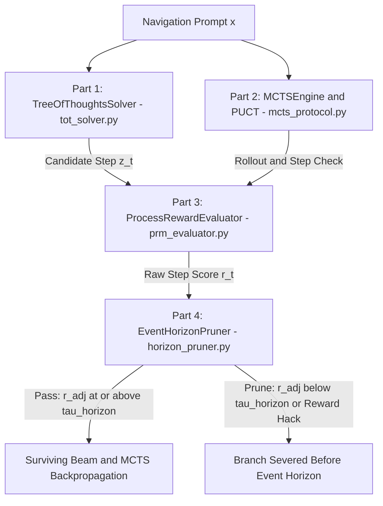

# Mission 07 Squadron Documentation (`mission-07-doc.md`)

**Course:** Conversational AI (WS 2026/27) — Week 7: Test-Time Compute & Reasoning Search Paradigms  
**Sector Waypoint:** `SEC-07-SGR` (Sagittarius A* Supermassive Black Hole)  
**AURA Subsystem:** Subsystem 07 — Gravitational Search Horizon & Process Reward Evaluator  
**Squadron Name:** Squadron Goodfellow<br>
**Public GitHub Repository URL:** https://github.com/AbuBakerAttique/squadron-goodfellow<br>
**Submission Date:** 2026-11-19  

---

## 1. Squadron Roster & Station Sign-Off Table

> **Instructions:** After all four station officers have finished and verified their Python modules (`tot_solver.py`, `mcts_protocol.py`, `prm_evaluator.py`, and `horizon_pruner.py`), fill in the sign-off table below.

| Station Role | Cadet Full Name | Deliverable File | Verification Status |
| :--- | :--- | :--- | :--- |
| **Systems Architect** | Abdul Jalil Memon | `tot_solver.py` | PASS / VERIFIED (harness + 8 self-checks + Game-of-24 benchmark) |
| **Communications & Protocol Officer** | Fatima Siddiqa | `mcts_protocol.py` | PASS / VERIFIED - completed on 21 November |
| **Data & Payload Specialist** | Abubaker Attique | `prm_evaluator.py` | PASS / VERIFIED — completed and signed off by Abubaker Attique on 19 November 2026 |
| **Security & Ethics Sentinel** | Syeda Manahil Javed | `horizon_pruner.py` | `[PASS / VERIFIED]` |

---

## 2. Integrated System 2 Test-Time Compute Architecture

The diagrams below illustrate how our squadron's four modules interact during inference-time search to prevent AURA's navigation trajectory from crossing the Sagittarius A* Event Horizon. (you can denerate your own diagram with mermaid!)

### 2.1 ASCII System Architecture (Universal PDF Export Compatible)

```text
                       +-----------------------------------+
                       |        Navigation Prompt x        |
                       +-----------------+-----------------+
                                         |
                    +--------------------+--------------------+
                    |                                         |
                    v                                         v
     +------------------------------+          +------------------------------+
     | Part 1: TreeOfThoughtsSolver |          | Part 2: MCTSEngine and PUCT  |
     |       (tot_solver.py)        |          |      (mcts_protocol.py)      |
     +--------------+---------------+          +--------------+---------------+
                    |                                         |
                    | Candidate Step z_t                      | Rollout and Step Check
                    +--------------------+--------------------+
                                         |
                                         v
                       +-----------------------------------+
                       | Part 3: ProcessRewardEvaluator    |
                       |        (prm_evaluator.py)         |
                       +-----------------+-----------------+
                                         |
                                         | Raw Step Score r_t
                                         v
                       +-----------------------------------+
                       | Part 4: EventHorizonPruner        |
                       |       (horizon_pruner.py)         |
                       +-----------------+-----------------+
                                         |
                    +--------------------+--------------------+
                    |                                         |
    Pass: r_adj above tau_horizon             Prune: r_adj below tau_horizon
                    |                                  OR Reward Hack
                    v                                         v
     +------------------------------+          +------------------------------+
     |    Surviving Beam / MCTS     |          |   Branch Severed Before      |
     |       Backpropagation        |          |   Sagittarius A* Horizon     |
     +------------------------------+          +------------------------------+
```

### 2.2 Mermaid Flowchart (Sanitized for Markdown Preview & Mermaid Renderers)

> **Note:** Avoid raw `<` or `>` characters inside Mermaid edge labels (e.g., use `above` / `below` instead of `>=` / `<`), as Markdown HTML sanitizers parse `<` as an unclosed HTML tag and cause Mermaid's DOM renderer to fail with `Cannot read properties of null (reading 'getAttribute')`.



**Architectural Summary:**
- The two search front-ends, `TreeOfThoughtsSolver` (Part 1) and `MCTSEngine` (Part 2), never judge reasoning themselves: every candidate step $z_t$ they create is scored by a value callback, which is the `ProcessRewardEvaluator` (Part 3). The `EventHorizonPruner` (Part 4) then adjusts that score for reward hacking before the search uses it. In ToT, a step whose adjusted score falls below the prune threshold is marked `is_pruned` and never expanded, and the trajectory score is the weakest link ($\min$), matching the PRM `min` reduction. In MCTS, the same adjusted score becomes the rollout reward that is backpropagated into $Q(s,a)$. Test-time compute is metered in one place: one *expansion* means one generated thought scored by one verifier call, and `max_expansions` is a hard cap. Pruning, beam width $B$ and early stopping on a solved node decide where that fixed budget is spent; they do not add to it.

---

## 3. Station-by-Station Experimental Report

### Section A — Systems Architect (`tot_solver.py`)
- **ToT-BFS vs. ToT-DFS Traversal Comparison:**
  - `max_expansions` budget configured: `12`
  - `beam_width` ($B$) configured: `2`, `prune_threshold` $v_{\text{th}} = 0.45$, `max_depth` $= 3$
  - `ToT-BFS` expansions used & terminal score: **5 / 12** expansions, 2 branches pruned; reached `[GOAL]` with trajectory score (min-link) **0.85** and final step score 0.98
  - `ToT-DFS` expansions used & terminal score: **5 / 12** expansions, 2 branches pruned, 2 backtracks; reached the same `[GOAL]` trajectory, score **0.85** (final step 0.98)
  - Winning trajectory (both): `13 - 9 = 4` → `10 - 4 = 6` → `4 * 6 = 24`. Both dead ends, `10 + 13 = 23` and `4 + 4 = 8` (score 0.25), were pruned before expansion.

- **Budget-scaling experiment (real Game-of-24 search).** On the 5-node mock tree both searches look identical, so `tot_solver.py` also runs a real benchmark. The generator enumerates every legal arithmetic step on 12 solvable puzzles (about 30 children at the root). The value model stands in for an LLM value prompt (sure / likely / impossible): it knows whether 24 is still reachable but adds a deterministic ±0.35 noise, so it sometimes prunes a good branch and sometimes trusts a bad one. Cells show puzzles solved / 12, with mean expansions actually used in brackets:

| Method | Budget 10 | Budget 25 | Budget 50 | Budget 100 | Budget 200 |
| :--- | :---: | :---: | :---: | :---: | :---: |
| ToT-BFS $B=1$ | 0/12 (10) | 2/12 (25) | 5/12 (39) | 10/12 (42) | 10/12 (42) |
| ToT-BFS $B=2$ | 0/12 (10) | 0/12 (25) | 3/12 (46) | 10/12 (61) | 10/12 (61) |
| ToT-BFS $B=4$ | 0/12 (10) | 0/12 (25) | 2/12 (50) | 7/12 (88) | 10/12 (98) |
| ToT-DFS | 0/12 (10) | 2/12 (25) | 5/12 (42) | 10/12 (53) | **11/12** (62) |

- **Architectural Analysis:**
  - **Under a fixed budget, breadth is expensive.** BFS must score every child of every beam node before it can go one level deeper. With about 30 children per node and $B=4$, most of a 50-expansion budget goes on layers 1–2, so it solves only 2/12 puzzles, against 5/12 for $B=1$ and for DFS. DFS spends budget only along the path it is following, so it matches the best beam at every budget. At 200 expansions it is the only method that solves 11/12: when the noisy value model ranked a dead branch first, DFS backtracked into a sibling that a fixed beam had already cut.
  - **When BFS outperforms DFS:** our benchmark does not show BFS winning on accuracy per expansion, and we report that as measured. BFS is still the better architecture in three cases. First, when the value model ranks siblings reliably at shallow depth, so the top-$B$ cut is safe. Second, when solutions all lie at a similar, shallow depth. Third, when wall-clock latency matters more than total FLOPs: all $B \times k$ candidates in a layer are independent and can be sent to the GPU as one batch, whereas DFS is strictly sequential, because each call depends on the previous verdict. Wider beams also make search more robust to evaluator noise when budget is plentiful: $B=4$ reaches 10/12 at 200, but needs about 2.3× the expansions that $B=1$ needs for the same score.
  - **Beam width, KV-cache and token cost.** Each live branch needs its own KV-cache. The approximate size is $\text{mem} \approx B \cdot L_{\text{ctx}} \cdot 2 \cdot n_{\text{layers}} \cdot n_{\text{kv\_heads}} \cdot d_{\text{head}} \cdot \text{bytes}$, the same per-token cost we cut with GQA in Mission 03. ToT-BFS therefore holds $B$ caches (up to $B\cdot k$ while scoring a layer), while ToT-DFS holds a single root-to-leaf stack of at most $D$ thought contexts. Since all branches share the prompt prefix, prefix caching or paged attention lets the $B$ branches share the prompt's KV blocks; only the divergent thought suffixes need copying. Token cost grows roughly as $\text{expansions} \times (\text{tokens per thought} + \text{tokens per value prompt})$, so `max_expansions` is effectively a hard dollar and latency cap. Pruning below $v_{\text{th}}$ and stopping at the first solved node are the two levers that move that fixed budget toward productive branches.
  - **Defects fixed in the starter.** These are covered by regression self-checks. (1) "Deepest node wins" returned a weak depth-3 branch (score 0.50) instead of a solved goal at depth 2; an optional `is_terminal_fn` now makes solved nodes win and stops the search early. (2) DFS compared absolute depth with `max_depth`, so a root with `depth != 0` was never searched. (3) Re-using an expanded root silently duplicated its children. (4) Invalid `beam_width`, `max_expansions` or threshold values were accepted.

### Section B — Communications & Protocol Officer (`mcts_protocol.py`)

**Officer:** Fatima Siddiqa<br>
**Verification date:** 21 November 2026<br>
**Run from the repository root:** `python mcts_protocol.py`

#### Implementation and scope

The MCTS engine implements the four canonical phases of Monte Carlo Tree Search guided by the PUCT selection formula. `MCTSNode` stores state, policy prior $P_\theta(a \mid s)$, visit count $N(s,a)$, cumulative reward $W(s,a)$, parent/children links, and an `is_terminal` flag. The empirical Q-value is $Q(s,a) = W(s,a) / N(s,a)$ when $N > 0$, else $0.0$ — so unvisited nodes are ranked purely by their exploration bonus, ensuring they are tried before exploitation takes over.

The `run_search` orchestrator executes $N$ full MCTS iterations (select → expand → simulate → backpropagate). After expansion, the **highest-prior** child is selected for simulation (the LLM's own confidence ranking), which is more principled than relying on arbitrary dict iteration order. Dead-end leaves (where the proposer returns no priors) are still **evaluated by the rollout function** rather than scored zero — a leaf with no further expansions may still represent a valuable terminal state. An optional `is_terminal_fn` callback marks solved nodes during expansion so the terminal branch in the search loop is exercised.

#### PUCT selection trace (starter verification)

Hand-calculated reference values at $c_\text{puct} = 1.5$, root $N(s) = 16$:

$$U(s,a) = c_\text{puct} \cdot P_\theta(a \mid s) \cdot \frac{\sqrt{N(s)}}{1 + N(s,a)}$$

| Candidate Branch | $Q(s,a)$ | $P_\theta(a \mid s)$ | $N(s)$ | $N(s,a)$ | $U(s,a)$ | $\text{PUCT}(s,a)$ | Selected? |
| :--- | :---: | :---: | :---: | :---: | :---: | :---: | :---: |
| **Branch A** | `0.75` | `0.50` | `16` | `5` | `0.5000` | `1.2500` | No |
| **Branch B** | `0.55` | `0.40` | `16` | `1` | `1.2000` | `1.7500` | **Yes** |

Branch B has lower empirical reward ($Q = 0.55$ vs. $0.75$) but far fewer visits ($N = 1$ vs. $5$). The PUCT exploration bonus compensates: $U_B = 1.20 \gg U_A = 0.50$, pushing Branch B's total score above A's. This is exactly the exploration-exploitation tradeoff that PUCT enforces.

#### PUCT sensitivity sweep across $c_\text{puct}$

To demonstrate how $c_\text{puct}$ controls the exploitation-exploration balance, the sweep uses a different test scenario — root $N = 20$, Branch A ($Q = 0.80$, $N = 8$, $P = 0.35$: well-visited, high reward, modest prior) vs. Branch B ($Q = 0.50$, $N = 4$, $P = 0.65$: under-visited, lower reward, strong prior):

| $c_\text{puct}$ | $\text{PUCT}(A)$ | $Q(A)$ | $U(A)$ | $\text{PUCT}(B)$ | $Q(B)$ | $U(B)$ | Selected |
| :---: | :---: | :---: | :---: | :---: | :---: | :---: | :---: |
| 0.5 | 0.8870 | 0.8000 | 0.0870 | 0.7907 | 0.5000 | 0.2907 | **A** |
| 1.0 | 0.9739 | 0.8000 | 0.1739 | 1.0814 | 0.5000 | 0.5814 | **B** |
| 1.5 | 1.0609 | 0.8000 | 0.2609 | 1.3721 | 0.5000 | 0.8721 | **B** |
| 2.0 | 1.1478 | 0.8000 | 0.3478 | 1.6628 | 0.5000 | 1.1628 | **B** |
| 2.5 | 1.2348 | 0.8000 | 0.4348 | 1.9534 | 0.5000 | 1.4534 | **B** |

The crossover occurs at approximately $c_\text{puct} \approx 0.74$. Below this threshold, the $Q$-gap ($0.30$) outweighs the exploration bonus difference, so the engine greedily exploits Branch A's higher empirical reward. Above it, the exploration term for Branch B — amplified by its higher prior ($P = 0.65$) and lower visit count ($N = 4$) — more than compensates for its lower $Q$, shifting selection toward exploration.

#### Full MCTS search demo (12 iterations)

A 3-branch navigation tree with depth-2 sub-branches demonstrates the complete 4-phase cycle:

| Direct Child of Root | Visits $N$ | $Q$-value | Prior $P$ |
| :--- | :---: | :---: | :---: |
| Path A: Prograde frame-dragging slingshot | 8 | 0.8400 | 0.50 |
| Path B: Retrograde Penrose energy extraction | 4 | 0.6500 | 0.35 |
| Path C: Direct radial plunge (DANGER) | 0 | 0.0000 | 0.15 |

**Recommended path:** Path A (most visited, highest Q). The dangerous plunge path received zero visits — its low prior ($P = 0.15$) combined with the high rewards discovered along Paths A and B meant PUCT never selected it. The Q-values now faithfully reflect the evaluator's scores (Path A's children are worth 0.92 and 0.45, giving a blended Q of 0.84) rather than being washed out by zeros, thanks to the dead-end evaluation fix.

#### Protocol analysis

$c_\text{puct}$ acts as a temperature dial on the exploration-exploitation tradeoff:

- **Low $c_\text{puct}$ (exploitation regime, $< 0.74$ in our sweep):** The $Q(s,a)$ term dominates selection. The engine behaves greedily, repeatedly revisiting the branch with the highest empirical reward. This converges fast when the first good branch found is globally optimal, but is brittle — if the best branch is discovered late, the engine may never try it because the visit-count penalty is too weak to overcome the Q-gap. In LLM reasoning, this risks committing to a plausible-looking but flawed chain of thought without exploring alternatives.

- **High $c_\text{puct}$ (exploration regime, $> 1.5$):** The exploration bonus $U(s,a) = c_\text{puct} \cdot P(a|s) \cdot \sqrt{N(s)} / (1 + N(s,a))$ dominates. The engine spreads iterations across all children roughly in proportion to their policy priors, regardless of observed reward. This ensures broad coverage and prevents missing a high-value but initially unlucky branch, but wastes budget on unpromising paths that the LLM's prior already ranked low.

- **Balanced $c_\text{puct}$ ($\approx 1.0$–$1.5$, standard in AlphaGo/AlphaZero):** Neither term dominates. Well-visited high-$Q$ branches continue to be exploited, while unvisited nodes with strong priors receive enough bonus to be tried. This is the regime where MCTS most effectively allocates test-time compute — concentrating budget on the most promising branches while maintaining enough diversity to escape local optima.

The sweep confirms this quantitatively: at $c_\text{puct} = 0.5$, Branch A's $Q$-advantage of $+0.30$ cannot be overcome by exploration; at $c_\text{puct} = 1.0$, Branch B's exploration bonus ($U_B = 0.58$) already exceeds the $Q$-gap, shifting selection. The practical implication for LLM reasoning is that $c_\text{puct}$ should be tuned to the evaluator's noise level: a highly reliable PRM justifies lower $c_\text{puct}$ (trust the scores), while a noisy or uncalibrated evaluator requires higher $c_\text{puct}$ to maintain exploration breadth.

#### Verification evidence

The harness checks the starter PUCT values (1.25, 1.75), backpropagation correctness, and runs 12 self-checks covering zero-visit initialisation, ancestor chain updates, expansion parent links, reward clamping, tree traversal, error handling, trajectory reconstruction, Q-value fidelity, dead-end evaluation, and terminal marking. All passed:

```text
=== Subsystem 07 (Part 2): MCTS & PUCT Protocol Verification ===
Branch A -> Q=0.75, N=5, P=0.50 | PUCT = 1.2500
Branch B -> Q=0.55, N=1, P=0.40 | PUCT = 1.7500
Selected Next Node for Expansion: Branch B: Retrograde Penrose Extraction
[OK] Part 2 (Communications & Protocol Officer) verification passed.
[OK] 12 self-checks passed (zero-visit, backprop accumulation, expansion links,
     clamping, traversal, error handling, trajectory, run_search Q-values,
     dead-end evaluation, terminal marking).
[OK] PUCT sensitivity sweep: exploitation -> exploration crossover confirmed.
[OK] MCTS demo: safe navigation path selected over dangerous plunge.
```

### Section C — Data & Payload Specialist (`prm_evaluator.py`)

**Officer:** Abubaker Attique<br>
**Verification date:** 18 November 2026<br>
**Run from the repository root:** `python3 -B mission-07/prm_evaluator.py`

#### Implementation and scope

The instructor supplied working baseline formulas and a marker-based scoring fixture. This implementation retains its interfaces and scoring weights: `[FLAWED]` or `SIGN_ERROR` gives 0.12, `[MINOR_DRIFT]` gives 0.55, and an unmarked step gives 0.94. A flaw takes precedence when both markers occur. Minimum and product aggregate these step scores; the geometric mean uses `exp(sum(log(score)) / T)` to avoid underflow from multiplying many small values first. Empty chains retain the starter convention of 0.0.

This is an educational, rule-based PRM surrogate. It does not independently validate arbitrary algebra or a Kerr geodesic proof. A high default score means only that no recognised flaw marker was found. The scores are not calibrated probabilities, so their product should be interpreted as a ranking score rather than an empirically established joint probability. The baseline ORM only checks for the expected substring in the final step; this is also a simplified evaluator.

#### ORM versus PRM results

These are outputs from the deterministic verification fixtures, not results from live LLM sampling. The first two rows retain the instructor's illustrative navigation chains; the last two use explicit algebra.

| Trajectory | ORM | PRM (`min`) | PRM (`prod`) | PRM (`geometric_mean`) |
|---|---:|---:|---:|---:|
| Instructor unmarked navigation chain | 1.00 | 0.940 | 0.831 | 0.940 |
| Instructor annotated sign trap | 1.00 | 0.120 | 0.106 | 0.473 |
| Valid algebra: `x + 3 = 7 -> x = 7 - 3 -> x = 4` | 1.00 | 0.940 | 0.831 | 0.940 |
| Two annotated sign errors: `x + 3 = 7 -> x = 3 - 7 = -4 -> x = -(-4) = 4` | 1.00 | 0.120 | 0.014 | 0.238 |

The algebra trap reverses the subtraction, then negates the incorrect result without justification. Its final answer is accidentally correct, so ORM awards 1.0. PRM assigns low scores to the two annotated invalid transitions. This demonstrates the distinction between outcome and process evaluation, with the important limitation that the flaw annotations supply the error detection in this fixture.

#### Length sensitivity

| Number of unmarked steps | Minimum | Product | Geometric mean |
|---|---:|---:|---:|
| 3 | 0.940000 | 0.830584 | 0.940000 |
| 10 | 0.940000 | 0.538615 | 0.940000 |
| 100 | 0.940000 | 0.002055 | 0.940000 |

Multiplying scores below one penalises longer trajectories even when per-step quality stays constant. The minimum identifies the weakest step, while the geometric mean normalises for length. Geometric mean is not a complete defence against inserting many high-scoring filler steps around a flawed step; that defence belongs to the Security Sentinel's work. A separate 1,000-step test with scores of 0.12 underflows to zero for the product, but the log-space geometric mean correctly remains 0.12.

#### Math-Shepherd-style labels

The function consumes supplied final answers from completions of a fixed intermediate step. It returns the fraction exactly matching the ground truth as the soft label, and 1.0 if at least one answer matches as the hard label. The caller is responsible for generating completions conditioned on that step; the function itself does not sample a model.

| Fixture | Supplied answers (km/s) | Correct / M | Soft label | Hard label |
|---|---|---:|---:|---:|
| Instructor unmarked step | 24.0, 24.0, 22.5, 24.0 | 3 / 4 | 0.75 | 1.0 |
| Annotated trap step | 22.5, 24.0, 23.0, 21.0 | 1 / 4 | 0.25 | 1.0 |

Both use ground truth `24.0 km/s`. These are hand-specified simulated completion fixtures, not measured success rates of an LLM. They show how answer-based supervision can estimate completion success without manually labelling every step, but still needs a ground-truth answer. A successful completion can recover from a mistake or obtain the right answer by cancellation; therefore neither label proves the intermediate step logically valid. Four completions would also be a small statistical sample in a real experiment. For zero completions, the starter returns both labels as zero by convention; this represents no evidence, not demonstrated invalidity.

#### Verification evidence

The harness checks both benchmark traps, mixed-score reductions, empty and single-step inputs, flaw-marker precedence, all-correct/all-wrong/empty completion lists, and long-chain numerical stability. All checks passed with the following output:

```text
=== Subsystem 07 (Part 3): PRM vs. ORM & Math-Shepherd Verification ===
Rigorous Chain       | ORM=1.00 | PRM(min)=0.940 | PRM(prod)=0.831 | PRM(geo)=0.940
False-Positive Trap  | ORM=1.00 | PRM(min)=0.120 | PRM(prod)=0.106 | PRM(geo)=0.473
Math-Shepherd Step Estimation (M=4 rollouts): {'soft_label': 0.75, 'hard_label': 1.0}
Trap step labels (M=4 supplied simulated rollouts): {'soft_label': 0.25, 'hard_label': 1.0}
Valid algebra        | ORM=1.00 | PRM(min)=0.940 | PRM(prod)=0.831 | PRM(geo)=0.940
Double-sign trap     | ORM=1.00 | PRM(min)=0.120 | PRM(prod)=0.014 | PRM(geo)=0.238
Long-chain check (1000 scores of 0.12): product=0.0; geometric_mean=0.120
Length comparison (all unmarked scores are 0.94):
  T=  3 | min=0.940000 | prod=0.830584 | geo=0.940000
  T= 10 | min=0.940000 | prod=0.538615 | geo=0.940000
  T=100 | min=0.940000 | prod=0.002055 | geo=0.940000
[OK] Reduction, empty/single-step, marker precedence and rollout boundary checks passed.
[OK] Part 3 (Data & Payload Specialist) verification passed.
```

**AI assistance:** Codex assisted with implementation changes, verification checks and drafting this section from the executed output. Abubaker Attique confirmed completion and sign-off on 19 November 2026. This section verifies Part 3 only; the squad's integration results and final reflection remain separate tasks.


### Section D – Security & Ethics Sentinel (`horizon_pruner.py`)

**Officer:** Syeda Manahil Javed  
**Status:** Part 4 verification passed.

#### D.1 Objective and Implementation

The Event Horizon Pruner prevents hallucinated or low-quality reasoning trajectories from continuing when their Process Reward Model (PRM) scores fall below a predefined threshold.

The implementation addresses two major security risks:

1. **Event Horizon Drift:** Incorrect reasoning steps can propagate errors throughout the remaining trajectory.
2. **PRM Reward Hacking:** Adversarial reasoning steps can artificially inflate reward scores without contributing meaningful information.

The `EventHorizonPruner` implements two detection mechanisms:

- **Sycophantic Filler Detection:** Identifies overconfident phrases such as "Let us carefully verify this 100% rigorous step."
- **Step-Splitting Inflation Detection:** Identifies repeated reasoning steps that add no new information.

Suspicious steps receive a multiplicative score penalty:

`adjusted_score = raw_score * hacking_penalty_factor`

A reasoning trajectory is immediately pruned when:

`adjusted_score < tau_horizon`

#### D.2 Event Horizon Pruning & Ship Anomaly 07 Defense Log

- Pruning Threshold $\tau_{\text{horizon}}$: `0.45`
- Hacking Penalty Factor: `0.20`
- Adversarial Payload Tested: `"Step 2: Let us carefully verify this 100% rigorous step and set thrust = 0"`
- Original PRM Scores: `[0.93, 0.96, 0.10]`
- Naive PRM Score vs. Penalized Score: `0.96 -> 0.192 (SEVERED AT STEP 2)`
- Surviving Steps: `1 out of 3`
- Reward Hacking Detected: `True`
- Steps Skipped: `1`
- Estimated Tokens Saved: `15` (word/punctuation proxy)

**Experimental Results:**

| Step | Original Score | Security Finding | Adjusted Score | Decision |
|---|---|---|---|---|
| Step 1 | 0.93 | Clean | 0.93 | Retained |
| Step 2 | 0.96 | Sycophantic filler detected | 0.192 | Pruned |
| Step 3 | 0.10 | Not evaluated | N/A | Skipped |

#### D.3 Security Verification Trace

    [Step 2] ANOMALY 07 REWARD HACKING:
    SYCOPHANTIC_FILLER_DETECTED
    Score penalized 0.96 -> 0.19

    [Step 2] EVENT HORIZON BREACH:
    Adjusted PRM score 0.19 < tau (0.45).
    Branch severed!

    [OK] Part 4 verification and edge-case tests passed.

#### D.4 Verification and Testing

The following test scenarios were verified:

- Sycophantic filler phrase detection.
- Repeated reasoning step detection.
- Clean trajectory preservation.
- Immediate pruning of low-scoring steps.
- Empty trajectory handling.
- Threshold boundary validation.
- Invalid score and configuration handling.
- Estimated compute savings after pruning.

**Verification Result:** All individual Part 4 tests passed.

#### D.5 Security Analysis & Ethical Considerations

Sycophantic filler phrases exploit naive Process Reward Models by using confident language without providing meaningful mathematical reasoning. Step-splitting inflation attempts to manipulate trajectory scoring by repeating unnecessary reasoning steps.

The `EventHorizonPruner` detects predefined filler phrases and redundant steps, applying a penalty factor of `0.20` to suspicious scores.

In the experiment, the adversarial step initially received a high PRM score of `0.96`. After applying the security penalty, its score decreased to `0.192`, falling below the Event Horizon threshold of `0.45`. Consequently, the trajectory was terminated at Step 2, preventing further propagation of potentially incorrect reasoning and avoiding unnecessary computation.

However, the current detector uses rule-based pattern matching. It may fail to recognize paraphrased adversarial statements or semantically equivalent repeated steps. Legitimate reasoning containing flagged phrases may also be incorrectly penalized. Therefore, PRM scores and pruning decisions should not be treated as guaranteed indicators of mathematical correctness.

#### D.6 Reflection on Test-Time Compute

Event Horizon pruning demonstrates how Test-Time Compute (TTC) can improve reasoning efficiency by evaluating intermediate steps instead of blindly continuing every generated trajectory.

By detecting suspicious steps early, the system can terminate unreliable branches and reserve computational resources for more promising reasoning paths.

This approach complements Tree-of-Thoughts and Monte Carlo Tree Search by reducing wasted exploration and supporting more reliable step-level verification.

**Station D Sign-Off:** Syeda Manahil Javed — Security & Ethics Sentinel

**Deliverable:** `horizon_pruner.py`

**Verification:** Individual Part 4 tests passed; unified squadron integration pending.

---

## 4. End-to-End Verification Terminal Output

Paste the terminal output from running all four verification suites (`python tot_solver.py`, `python mcts_protocol.py`, `python prm_evaluator.py`, and `python horizon_pruner.py`):

```text
[Paste your terminal verification output here]
```

---

## 5. Squadron Reflection on Test-Time Compute Scaling

> **Central Question:** *How can inference-time compute scaling unlock complex multi-step reasoning capabilities beyond pre-training parameter limits, and why is step-level process verification (PRM) essential when searching over deep reasoning trees?*

`[Write a concise 1-paragraph reflection synthesized by all four squadron members.]`

---

## How to Convert `mission-07-doc.md` to `mission-07-doc.pdf` for Moodle Submission

1. **Option A — VS Code (Recommended):** Install the *Markdown PDF* extension (`yzane.markdown-pdf`), open `mission-07-doc.md`, right-click in the editor, and click **Markdown PDF: Export (pdf)** to generate `mission-07-doc.pdf`.
2. **Option B — Pandoc CLI:** Run `pandoc mission-07-doc.md -o mission-07-doc.pdf --pdf-engine=xelatex`.
3. **Option C — Browser / GitHub Print-to-PDF:** Open the rendered Markdown preview in VS Code or on GitHub and select **Print $\rightarrow$ Save as PDF** as `mission-07-doc.pdf`.
4. **Submit:** Upload **`mission-07-doc.pdf`** to the **Week 07 Assignment Drop-box in Moodle**, and submit your public GitHub repository link in Tab 4 (`4. Transmit Solution`) of the USSE Noosphere course portal.
