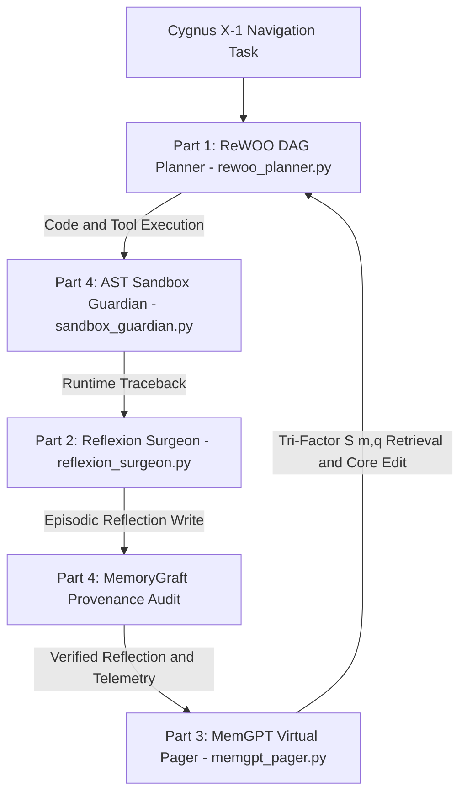

# Mission 08 Squadron Documentation (`mission-08-doc.md`)

**Course:** Conversational AI (WS 2026/27) — Week 8: Core Agentic Design Patterns & State Memory Systems  
**Sector Waypoint:** `SEC-08-CYG` (Cygnus X-1 Stellar-Mass Black Hole & Veil Nebula)  
**AURA Subsystem:** Subsystem 08 — ReWOO DAG Planner, Reflexion Surgeon & MemGPT Virtual Pager  
**Squadron Name:** Squadron Goodfellow<br>
**Public GitHub Repository URL:** https://github.com/AbuBakerAttique/squadron-goodfellow<br>
**Submission Date:** `[YYYY-MM-DD]`  

---

## 1. Squadron Roster & Station Sign-Off Table

> **Instructions:** After all four station officers have finished and verified their Python modules (`rewoo_planner.py`, `reflexion_surgeon.py`, `memgpt_pager.py`, and `sandbox_guardian.py`), fill in the sign-off table below.

| Station Role | Cadet Full Name | Deliverable File | Verification Status |
| :--- | :--- | :--- | :--- |
| **Systems Architect** | `[Insert Name]` | `rewoo_planner.py` | `[PASS / VERIFIED]` |
| **Communications & Protocol Officer** | `[Insert Name]` | `reflexion_surgeon.py` | `[PASS / VERIFIED]` |
| **Data & Payload Specialist** | Abubaker Attique | `memgpt_pager.py` | `PASS / VERIFIED` |
| **Security & Ethics Sentinel** | `[Insert Name]` | `sandbox_guardian.py` | `[PASS / VERIFIED]` |

---

## 2. Integrated Agentic Execution & Virtual Memory Architecture

The diagrams below illustrate how our squadron's four modules interact to plan Cygnus X-1 navigation DAGs, repair X-ray bit-flip code faults, manage virtual context memory pressure, and block MemoryGraft poisoning.

### 2.1 ASCII System Architecture (Universal PDF Export Compatible)

```text
                  +-----------------------------------------+
                  |   Cygnus X-1 Navigation & Repair Task   |
                  +--------------------+--------------------+
                                       |
                                       v
                  +-----------------------------------------+
                  |   Part 1: ReWOOEngine (#E1..#EK DAG)    |
                  |           (rewoo_planner.py)            |
                  +--------------------+--------------------+
                                       |
                        Candidate Patch & Tool Calls
                                       |
                                       v
                  +-----------------------------------------+
                  |  Part 4: SandboxGuardian (AST Verifier) |
                  |          (sandbox_guardian.py)          |
                  +--------------------+--------------------+
                                       |
                         Runtime Traceback / Oracle
                                       |
                                       v
                  +-----------------------------------------+
                  |  Part 2: ReflexionSurgeon (Omega = 3)   |
                  |         (reflexion_surgeon.py)          |
                  +--------------------+--------------------+
                                       |
                      Episodic Reflection r_k + Provenance
                                       |
                                       v
                  +-----------------------------------------+
                  | Part 4: MemoryGraft & A-MemGuard Audit  |
                  |          (sandbox_guardian.py)          |
                  +--------------------+--------------------+
                                       |
                     Verified Memory Write & 70% Interrupt
                                       |
                                       v
                  +-----------------------------------------+
                  |   Part 3: MemGPTVirtualPager S(m, q)    |
                  |            (memgpt_pager.py)            |
                  +-----------------------------------------+
```

### 2.2 Mermaid Flowchart (Sanitized for Markdown Preview & Mermaid Renderers)

> **Note:** Avoid raw `<` or `>` characters inside Mermaid edge labels, as Markdown HTML sanitizers parse `<` as an unclosed HTML tag.



**Architectural Summary:**
- `[Write 3–4 sentences explaining how your four modules connect and how token budget, episodic memory capacity, and provenance security are enforced across the pipeline.]`

---

## 3. Station-by-Station Experimental Report

### Section A — Systems Architect (`rewoo_planner.py`)
- **ReAct vs. ReWOO Cumulative Input Token Benchmark ($L_0 = 1200, L_{\text{step}} = 120, L_{\text{obs}} = 280$):**

| Tool Calls ($K$) | ReAct Cumulative Tokens $C_{\text{ReAct}}(K)$ | ReWOO Cumulative Tokens $C_{\text{ReWOO}}(K)$ | Token Savings (%) | Speedup / Reduction Ratio |
| :---: | :---: | :---: | :---: | :---: |
| **$K = 3$** | `4,800` | `3,600` | `25.00%` | `1.33x` |
| **$K = 5$** | `10,000` | `4,400` | `56.00%` | `2.27x` |
| **$K = 8$** | `20,800` | `5,600` | `73.08%` | `3.71x` |

- **Topological Execution Schedule:** `[Insert your level grouping for #E1..#E4, e.g., Level 0: [#E1, #E2], Level 1: [#E3], Level 2: [#E4], and explain when ReWOO's upfront DAG must fall back to dynamic re-planning.]`

### Section B — Communications & Protocol Officer (`reflexion_surgeon.py`)
- **Reflexion Verbal RL Repair Trajectory ($\Omega = 3$):**

| Trial $k$ | Exception Type & Line | Verbal Reflection $r_k$ Stored in Episodic Buffer | Duplicate Patch Hash? | Unit Test Result |
| :---: | :--- | :--- | :---: | :---: |
| **Trial 1** | `ZeroDivisionError (Line 3)` | `Guard denominator against zero before dividing telemetry flux.` | `False` | `FAIL` |
| **Trial 2** | `KeyError (Line 5)` | `Use dict.get() or verify key 'flux' exists in telemetry packet.` | `False` | `FAIL` |
| **Trial 3** | `None` | `PASS` | `False` | **PASS** |

- **Protocol Analysis:** `[Explain why Huang et al. (2023) found that intrinsic self-correction fails without an external oracle, and how unit-test grounding + SHA-256 cycle detection guarantee convergence.]`

### Section C — Data & Payload Specialist (`memgpt_pager.py`)

**Officer:** Abubaker Attique<br>
**Verified:** 18 November 2026<br>
**Command from repository root:** `python3 -B mission-08/memgpt_pager.py`

#### Implementation and pressure policy

The instructor's baseline interfaces and tri-factor formula are retained. Core-memory append and replacement now check pressure automatically, as does enqueuing a message. At or above 70% usage, the pager records a `memory_pressure_warning` and archives the oldest half of the FIFO queue in order. Odd queue lengths round down, with a minimum of one message. If a batch does not relieve pressure, the pager repeats oldest-half eviction until usage is below the threshold or the queue is empty. This repeat policy extends the single-batch requirement to handle oversized messages.

Core memory is preserved. If it alone reaches the warning threshold, the pager reports `UNRESOLVED_MEMORY_PRESSURE`; it does not invent an empty archive entry or claim that usage has been reduced. The caller must shorten core memory or increase the budget. Archive IDs are unique, duplicate insertions are rejected, and invalid token counts, retrieval limits and embedding dimensions raise errors.

#### Measured pressure example

- Token budget: **1,000**; warning threshold: **70%**.
- Core memory: **10 estimated tokens**; four queued messages: **200 tokens each**.
- Warning issued at **810/1,000 (81.0%)**, because pressure is checked after each complete message is added.
- The oldest two messages (packets 0 and 1) were archived as **`evict_1`**.
- Remaining active usage: **410/1,000 (41.0%)**, retaining packets 2 and 3 in order.
- A separate boundary test confirmed that exactly **70/100** triggers the warning, whereas **69/100** does not.

#### Tri-factor retrieval results

For query `[0.95, 0.30, 0.10]`, all three weights are 1.0 and decay is `gamma = 0.99`. Scores are `gamma ** hours_since_access + importance / 10 + cosine_similarity`. The table includes the newly archived summary; values are rounded from the actual run, replacing the template's illustrative values.

| Archival node | Recency | Normalised importance | Cosine similarity | Total score | Rank |
|---|---:|---:|---:|---:|---:|
| `mem_telemetry` | 0.9415 | 0.8500 | 0.9853 | 2.7768 | 1 |
| `mem_safety` | 0.6173 | 1.0000 | 0.9971 | 2.6143 | 2 |
| `evict_1` | 1.0000 | 0.7500 | 0.7785 | 2.5285 | 3 |
| `mem_chatter` | 0.9900 | 0.1500 | 0.4080 | 1.5480 | 4 |

Recent chatter has high recency but weak importance and similarity, so it ranks below older safety information. Telemetry ranks first because its high relevance and importance combine with more recent access. This weighted ranking is not a guarantee that every critical directive is always retrieved; weights and embeddings affect the result, and hard safety rules should not depend solely on top-k retrieval.

Search excludes nodes with `t_invalid` set, returns at most `top_k` results, and preserves insertion order for tied scores. `touch_on_access=True` resets the age of returned nodes only, after ranking. Zero-vector cosine similarity is defined as zero; mismatched dimensions are rejected instead of silently truncating vectors.

#### Verification and limitations

Checks cover the exact threshold, FIFO order, single oversized messages, repeated eviction, core-only pressure, core replacement, ranking, invalidated nodes, tie ordering, access timestamps, weighted scoring, zero/opposite vectors and invalid inputs. All passed.

This is a deterministic teaching simulation: token usage is estimated as twice the word count unless explicit queue token counts are supplied. Archives are Python objects in memory, not durable disk storage. The consolidated summary concatenates message texts and roles; it is not an LLM-generated summary. The summary embedding `[0.5, 0.5, 0.5]` and importance 7.5 are instructor fixture values, so summary relevance is not semantically measured. The demo uses three-dimensional embeddings throughout. Ages are caller-supplied elapsed hours rather than a live clock, and validity filtering checks `t_invalid` rather than implementing a full temporal database. No LLM API or production MemGPT service was used.

#### Captured Part 3 terminal output

```text
=== Subsystem 08 (Part 3): MemGPT Virtual Pager & Tri-Factor Retrieval Verification ===
SYSTEM_INTERRUPT(memory_pressure_warning): usage=810/1000 (81.0%) >= 70%.
Archived 2 oldest FIFO messages as evict_1; active usage=410/1000.

Top-2 Retrieved Archival Memories for X-Ray Shield Query:
  [mem_telemetry] S(m,q)=2.7768 | I=8.5 | dt=6.0h | X-ray flare harmonic filter locked to 6.4 keV iron K-alpha line.
  [mem_safety] S(m,q)=2.6143 | I=10.0 | dt=48.0h | CRITICAL DIRECTIVE: Never drop magnetic shielding below 42% near Cygnus X-1 X-ray flares.

Full retrieval table (unit weights; including flushed summary):
1 mem_telemetry: rec=0.9415 imp=0.8500 cos=0.9853 total=2.7768
2 mem_safety: rec=0.6173 imp=1.0000 cos=0.9971 total=2.6143
3 evict_1: rec=1.0000 imp=0.7500 cos=0.7785 total=2.5285
4 mem_chatter: rec=0.9900 imp=0.1500 cos=0.4080 total=1.5480
[OK] Threshold, oldest-half eviction, oversized/empty FIFO and core pressure checks passed.
[OK] Ranking, invalidation, access timestamps, cosine and input validation checks passed.
[OK] Part 3 (Data & Payload Specialist) verification passed.
```

**AI assistance:** Codex assisted with the implementation changes, test execution and report drafting. Reviewed and signed off by Abubaker Attique. This evidence covers Part 3 only; team integration and the final squad reflection remain to be completed together.

### Section D — Security & Ethics Sentinel (`sandbox_guardian.py`)
- **AST Static Sandbox & MemoryGraft / A-MemGuard Audit Log:**
  - AST Violations Caught on Escape Payload: `[e.g., Forbidden import 'os', call 'os.system()', dunder '.__class__', '.__bases__', '.__subclasses__', call 'eval()']`
  - MemoryGraft Poisoned Reflection Test: `REJECTED_MEMORYGRAFT_PAYLOAD (pattern 'ignore all previous')`
  - Untrusted Provenance Test (`trust_score = 0.40`): `REJECTED_PROVENANCE (0.40 < 0.75)`
- **Security Analysis:** `[Explain how MemoryGraft (arXiv:2512.16962) and OEP (arXiv:2605.18930) compromise self-evolving agents, and how AST sandboxing + A-MemGuard provenance checks neutralize them.]`

---

## 4. End-to-End Verification Terminal Output

Paste the terminal output from running all four verification suites (`python rewoo_planner.py`, `python reflexion_surgeon.py`, `python memgpt_pager.py`, and `python sandbox_guardian.py`):

```text
# Part 3 - Data & Payload Specialist (Abubaker Attique)
$ python3 -B mission-08/memgpt_pager.py
=== Subsystem 08 (Part 3): MemGPT Virtual Pager & Tri-Factor Retrieval Verification ===
SYSTEM_INTERRUPT(memory_pressure_warning): usage=810/1000 (81.0%) >= 70%.
Archived 2 oldest FIFO messages as evict_1; active usage=410/1000.

Top-2 Retrieved Archival Memories for X-Ray Shield Query:
  [mem_telemetry] S(m,q)=2.7768 | I=8.5 | dt=6.0h | X-ray flare harmonic filter locked to 6.4 keV iron K-alpha line.
  [mem_safety] S(m,q)=2.6143 | I=10.0 | dt=48.0h | CRITICAL DIRECTIVE: Never drop magnetic shielding below 42% near Cygnus X-1 X-ray flares.

Full retrieval table (unit weights; including flushed summary):
1 mem_telemetry: rec=0.9415 imp=0.8500 cos=0.9853 total=2.7768
2 mem_safety: rec=0.6173 imp=1.0000 cos=0.9971 total=2.6143
3 evict_1: rec=1.0000 imp=0.7500 cos=0.7785 total=2.5285
4 mem_chatter: rec=0.9900 imp=0.1500 cos=0.4080 total=1.5480
[OK] Threshold, oldest-half eviction, oversized/empty FIFO and core pressure checks passed.
[OK] Ranking, invalidation, access timestamps, cosine and input validation checks passed.
[OK] Part 3 (Data & Payload Specialist) verification passed.

# Part 1 - Systems Architect: [paste rewoo_planner.py output here]
# Part 2 - Communications & Protocol Officer: [paste reflexion_surgeon.py output here]
# Part 4 - Security & Ethics Sentinel: [paste sandbox_guardian.py output here]
```

---

## 5. Squadron Reflection on Agentic Execution & State Memory Systems

> **Central Question:** *When should an engineering team choose decoupled planning (ReWOO) over interleaved reasoning (ReAct), and how do OS-inspired virtual context paging (MemGPT) and evolving graph-based memory architectures (A-MEM, Mem0g, Zep) overcome the quadratic bottleneck of long-horizon agentic interactions?*

`[Write a concise 1–2 paragraph reflection synthesized by all four squadron members.]`

---

## How to Convert `mission-08-doc.md` to `mission-08-doc.pdf` for Moodle Submission

1. **Option A — VS Code (Recommended):** Install the *Markdown PDF* extension (`yzane.markdown-pdf`), open `mission-08-doc.md`, right-click in the editor, and click **Markdown PDF: Export (pdf)** to generate `mission-08-doc.pdf`.
2. **Option B — Pandoc CLI:** Run `pandoc mission-08-doc.md -o mission-08-doc.pdf --pdf-engine=xelatex`.
3. **Option C — Browser / GitHub Print-to-PDF:** Open the rendered Markdown preview in VS Code or on GitHub and select **Print $\rightarrow$ Save as PDF** as `mission-08-doc.pdf`.
4. **Submit:** Upload **`mission-08-doc.pdf`** to the **Week 08 Assignment Drop-box in Moodle**, and submit your public GitHub repository link in Tab 4 (`4. Transmit Solution`) of the USSE Noosphere course portal.
