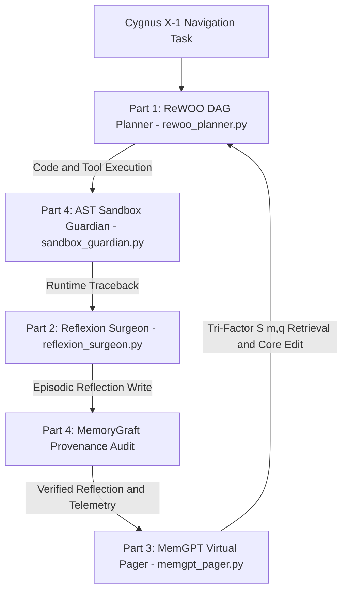

# Mission 08 Squadron Documentation (`mission-08-doc.md`)

**Course:** Conversational AI (WS 2026/27) — Week 8: Core Agentic Design Patterns & State Memory Systems  
**Sector Waypoint:** `SEC-08-CYG` (Cygnus X-1 Stellar-Mass Black Hole & Veil Nebula)  
**AURA Subsystem:** Subsystem 08 — ReWOO DAG Planner, Reflexion Surgeon & MemGPT Virtual Pager  
**Squadron Name:** Squadron Goodfellow<br>
**Public GitHub Repository URL:** https://github.com/AbuBakerAttique/squadron-goodfellow<br>
**Submission Date:** `[YYYY-MM-DD]`  

---

## 1. Squadron Roster & Station Sign-Off Table

> **Instructions:** After all four station officers have finished and verified their Python modules (`rewoo_planner.py`, `reflexion_surgeon.py`, `memgpt_pager.py`, and `sandbox_guardian.py`), fill in the sign-off table below.

| Station Role | Cadet Full Name | Deliverable File | Verification Status |
| :--- | :--- | :--- | :--- |
| **Systems Architect** | Abdul Jalil Memon | `rewoo_planner.py` | `PASS / VERIFIED` |
| **Communications & Protocol Officer** | Fatima Siddiqa | `reflexion_surgeon.py` | `PASS / VERIFIED` |
| **Data & Payload Specialist** | Abubaker Attique | `memgpt_pager.py` | `PASS / VERIFIED` |
| **Security & Ethics Sentinel** | `[Insert Name]` | `sandbox_guardian.py` | `[PASS / VERIFIED]` |

---

## 2. Integrated Agentic Execution & Virtual Memory Architecture

The diagrams below illustrate how our squadron's four modules interact to plan Cygnus X-1 navigation DAGs, repair X-ray bit-flip code faults, manage virtual context memory pressure, and block MemoryGraft poisoning.

### 2.1 ASCII System Architecture (Universal PDF Export Compatible)

```text
                  +-----------------------------------------+
                  |   Cygnus X-1 Navigation & Repair Task   |
                  +--------------------+--------------------+
                                       |
                                       v
                  +-----------------------------------------+
                  |   Part 1: ReWOOEngine (#E1..#EK DAG)    |
                  |           (rewoo_planner.py)            |
                  +--------------------+--------------------+
                                       |
                        Candidate Patch & Tool Calls
                                       |
                                       v
                  +-----------------------------------------+
                  |  Part 4: SandboxGuardian (AST Verifier) |
                  |          (sandbox_guardian.py)          |
                  +--------------------+--------------------+
                                       |
                         Runtime Traceback / Oracle
                                       |
                                       v
                  +-----------------------------------------+
                  |  Part 2: ReflexionSurgeon (Omega = 3)   |
                  |         (reflexion_surgeon.py)          |
                  +--------------------+--------------------+
                                       |
                      Episodic Reflection r_k + Provenance
                                       |
                                       v
                  +-----------------------------------------+
                  | Part 4: MemoryGraft & A-MemGuard Audit  |
                  |          (sandbox_guardian.py)          |
                  +--------------------+--------------------+
                                       |
                     Verified Memory Write & 70% Interrupt
                                       |
                                       v
                  +-----------------------------------------+
                  |   Part 3: MemGPTVirtualPager S(m, q)    |
                  |            (memgpt_pager.py)            |
                  +-----------------------------------------+
```

### 2.2 Mermaid Flowchart (Sanitized for Markdown Preview & Mermaid Renderers)

> **Note:** Avoid raw `<` or `>` characters inside Mermaid edge labels, as Markdown HTML sanitizers parse `<` as an unclosed HTML tag.



**Architectural Summary:**
- The ReWOO planner (Part 1) turns a task into a full `#E1..#EK` dependency graph in one Planner call. Its Worker runs that graph level by level, and the Solver reads all the evidence in one more call. This keeps the input-token cost linear in $K$ instead of quadratic. Any code patch or tool call that the plan produces passes through the AST `SandboxGuardian` (Part 4) before it runs. A failing run returns a real traceback to the `ReflexionSurgeon` (Part 2), which keeps at most $\Omega = 3$ reflections and stops repeated patches with SHA-256 hashes. Each reflection is checked by the MemoryGraft / A-MemGuard provenance audit (Part 4), which rejects `trust_score < 0.75` and injected directives, before it is written to the `MemGPTVirtualPager` (Part 3). The pager raises an interrupt at 70% of the token budget, moves the oldest half of the FIFO queue into archival memory, and returns ranked memories to the next ReWOO plan through $S(m, q)$. The token budget is therefore enforced in two places (ReWOO's linear prompts and MemGPT's 70% interrupt), episodic memory is capped by $\Omega$, and every write into persistent memory passes a provenance check.

---

## 3. Station-by-Station Experimental Report

### Section A — Systems Architect (`rewoo_planner.py`)
- **ReAct vs. ReWOO Cumulative Input Token Benchmark ($L_0 = 1200, L_{\text{step}} = 120, L_{\text{obs}} = 280$):**

| Tool Calls ($K$) | ReAct Cumulative Tokens $C_{\text{ReAct}}(K)$ | ReWOO Cumulative Tokens $C_{\text{ReWOO}}(K)$ | Token Savings (%) | Speedup / Reduction Ratio |
| :---: | :---: | :---: | :---: | :---: |
| **$K = 3$** | `4,800` | `3,600` | `25.00%` | `1.33x` |
| **$K = 5$** | `10,000` | `4,400` | `56.00%` | `2.27x` |
| **$K = 8$** | `20,800` | `5,600` | `73.08%` | `3.71x` |

**Officer:** Abdul Jalil Memon<br>
**Run from the `mission-08` folder:** `python rewoo_planner.py` (verification harness, self-checks and benchmark)

- **The table above is the closed-form model, and it matches our run exactly.** We also printed $K = 1$ and $K = 2$: ReWOO costs **more** there (2,800 vs 1,200 and 3,200 vs 2,800 tokens), because it always pays for two copies of the $L_0$ prompt, one for the Planner and one for the Solver. The difference is $C_{\text{ReAct}} - C_{\text{ReWOO}} = (K-2)L_0 + (L_{\text{step}}+L_{\text{obs}})\,K(K-3)/2$. That is negative at $K = 2$ and equal to $+L_0$ at $K = 3$. So with any non-empty prompt, ReWOO pays off from three tool calls upwards.

- **Topological Execution Schedule:** Level 0: `[#E1, #E2]` (X-ray scan and plasma probe are independent). Level 1: `[#E3]` (the Hohmann calculation needs both). Level 2: `[#E4]` (shield modulation needs the burn vector). Before a step runs, its `#E` references are replaced with the outputs of earlier levels.

- **Measured benchmark (real prompts, not the formula).** To check the model, the script builds the actual input prompt of every LLM call and counts its tokens. A ReAct call sees the system prompt plus all earlier Thought/Action/Observation blocks. The ReWOO Planner sees the system prompt; the Solver sees the system prompt plus the plan and the evidence. We count tokens with a simple word-and-punctuation regex, not a real BPE tokenizer, so absolute numbers would differ for a production model, but the ratio between methods is what matters. Tool latency is simulated with a 50 ms sleep per tool call.

| Plan | LLM calls (ReAct / ReWOO) | ReAct input tokens | ReWOO input tokens | Savings | Worker time, serial | Worker time, level-parallel |
| :--- | :---: | :---: | :---: | :---: | :---: | :---: |
| Cygnus blueprint, $K=4$, 3 levels | 4 / 2 | 644 | 404 | 37.27% (1.59x) | ~202 ms | ~155 ms (1.31x) |
| 6-scan survey, $K=8$, 3 levels | 8 / 2 | 1,621 | 589 | 63.66% (2.75x) | ~404 ms | ~154 ms (2.63x) |

  The measured savings are higher than the formula's at the same $K$ for a reason the constant-length model leaves out. ReAct's actions carry the **resolved** arguments, so the full text of `#E1` and `#E2` is copied again into the `#E3` action and then into `#E4`. ReWOO's plan carries only the short symbolic `#E3`. Latency follows the number of levels, not $K$: the 8-step survey takes the same three 50 ms rounds as the 4-step plan. ReAct cannot do this, because each Thought must wait for the previous Observation. (The timings vary slightly between runs.)

- **When the upfront DAG must fall back to re-planning.** ReWOO commits to its whole plan before it sees any observation. That works when the tool chain is known in advance and later arguments only *reuse* earlier outputs. It breaks when an observation should *change the plan*: a sensor fault (`ERR_CORONA_SPIKE`), a tool that crashes, or a result that makes the remaining steps pointless or calls for a different tool. Without a fallback, the error string is passed into every downstream step. Our `execute_dag` sends both `ERR_` outputs and tool exceptions to `fallback_replan_fn(var_name, error)`. In the harness, `#E1` returns `ERR_CORONA_SPIKE`, the fallback supplies a backup flux reading, and `#E3`/`#E4` run with the replacement. Errors the fallback cannot fix are recorded in `failed_steps` so the caller can re-plan. If the task is open-ended or exploratory, so that the next tool really depends on what was just seen, interleaved ReAct is the better choice even at $O(K^2)$ cost.

- **Defects fixed in the starter.** Each fix has a regression self-check. (1) Substitution used `str.replace` and so rewrote the `#E1` prefix inside `#E10`. In an 11-step plan, `#E11` received `T1(x1)0` instead of `#E10`'s output. Text that was already substituted was also scanned again, so a tool output containing "#E2" was overwritten. Substitution is now a single regex pass over whole `#E\d+` tokens. (2) A duplicated `#E` variable or a malformed step line was silently dropped, so the plan ran with steps missing; both now raise `ValueError`. (3) An undefined reference was reported as a cycle; the two cases now get separate errors. (4) A tool that raised an exception skipped the fallback re-planner. (5) Unknown tools were only detected after earlier tools had already run. (6) Steps in the same level were never actually run in parallel; `max_workers > 1` now runs each level on a thread pool, and the evidence is identical to the serial run. (7) Negative $K$ or token sizes were accepted.

### Section B — Communications & Protocol Officer (`reflexion_surgeon.py`)
- **Reflexion Verbal RL Repair Trajectory ($\Omega = 3$):**

| Trial $k$ | Exception Type & Line | Verbal Reflection $r_k$ Stored in Episodic Buffer | Duplicate Patch Hash? | Unit Test Result |
| :---: | :--- | :--- | :---: | :---: |
| **Trial 1** | `ZeroDivisionError (Line 3)` | `Guard denominator against zero before dividing telemetry flux.` | `False` | `FAIL` |
| **Trial 2** | `KeyError (Line 5)` | `Use dict.get() or verify key 'flux' exists in telemetry packet.` | `False` | `FAIL` |
| **Trial 3** | `None` | `PASS` | `False` | **PASS** |

- **Protocol Analysis:** Huang et al. (2023) showed that when an LLM revises its own answer without external feedback, it cannot reliably tell correct output from incorrect output, so accuracy stays flat or drops. Our baseline reproduces two failure modes. In (A), an intrinsic self-check approved the buggy normalize_xray_flux on the first trial, but our executing UnitTestEvaluator showed it still raised ZeroDivisionError. In (B), a self-check that was never satisfied produced only comment edits, and 3 of 3 rewrites hashed identically to the original. Grounding fixes this because the oracle's verdict is deterministic and its traceback is a concrete signal: the grounded loop went from ZeroDivisionError (line 3) to KeyError (line 5) to a pass in 3 trials, with each reflection written from a real traceback. SHA-256 cycle detection supplements this by detecting when the Actor repeats an already-evaluated patch, skipping the wasted evaluation, and aborting after repeated duplicates. It does not guarantee convergence. Convergence still depends on the Actor producing a new, better patch within max_trials.

### Section C — Data & Payload Specialist (`memgpt_pager.py`)

**Officer:** Abubaker Attique<br>
**Verified:** 18 November 2026<br>
**Command from repository root:** `python3 -B mission-08/memgpt_pager.py`

#### Implementation and pressure policy

The instructor's baseline interfaces and tri-factor formula are retained. Core-memory append and replacement now check pressure automatically, as does enqueuing a message. At or above 70% usage, the pager records a `memory_pressure_warning` and archives the oldest half of the FIFO queue in order. Odd queue lengths round down, with a minimum of one message. If a batch does not relieve pressure, the pager repeats oldest-half eviction until usage is below the threshold or the queue is empty. This repeat policy extends the single-batch requirement to handle oversized messages.

Core memory is preserved. If it alone reaches the warning threshold, the pager reports `UNRESOLVED_MEMORY_PRESSURE`; it does not invent an empty archive entry or claim that usage has been reduced. The caller must shorten core memory or increase the budget. Archive IDs are unique, duplicate insertions are rejected, and invalid token counts, retrieval limits and embedding dimensions raise errors.

#### Measured pressure example

- Token budget: **1,000**; warning threshold: **70%**.
- Core memory: **10 estimated tokens**; four queued messages: **200 tokens each**.
- Warning issued at **810/1,000 (81.0%)**, because pressure is checked after each complete message is added.
- The oldest two messages (packets 0 and 1) were archived as **`evict_1`**.
- Remaining active usage: **410/1,000 (41.0%)**, retaining packets 2 and 3 in order.
- A separate boundary test confirmed that exactly **70/100** triggers the warning, whereas **69/100** does not.

#### Tri-factor retrieval results

For query `[0.95, 0.30, 0.10]`, all three weights are 1.0 and decay is `gamma = 0.99`. Scores are `gamma ** hours_since_access + importance / 10 + cosine_similarity`. The table includes the newly archived summary; values are rounded from the actual run, replacing the template's illustrative values.

| Archival node | Recency | Normalised importance | Cosine similarity | Total score | Rank |
|---|---:|---:|---:|---:|---:|
| `mem_telemetry` | 0.9415 | 0.8500 | 0.9853 | 2.7768 | 1 |
| `mem_safety` | 0.6173 | 1.0000 | 0.9971 | 2.6143 | 2 |
| `evict_1` | 1.0000 | 0.7500 | 0.7785 | 2.5285 | 3 |
| `mem_chatter` | 0.9900 | 0.1500 | 0.4080 | 1.5480 | 4 |

Recent chatter has high recency but weak importance and similarity, so it ranks below older safety information. Telemetry ranks first because its high relevance and importance combine with more recent access. This weighted ranking is not a guarantee that every critical directive is always retrieved; weights and embeddings affect the result, and hard safety rules should not depend solely on top-k retrieval.

Search excludes nodes with `t_invalid` set, returns at most `top_k` results, and preserves insertion order for tied scores. `touch_on_access=True` resets the age of returned nodes only, after ranking. Zero-vector cosine similarity is defined as zero; mismatched dimensions are rejected instead of silently truncating vectors.

#### Verification and limitations

Checks cover the exact threshold, FIFO order, single oversized messages, repeated eviction, core-only pressure, core replacement, ranking, invalidated nodes, tie ordering, access timestamps, weighted scoring, zero/opposite vectors and invalid inputs. All passed.

This is a deterministic teaching simulation: token usage is estimated as twice the word count unless explicit queue token counts are supplied. Archives are Python objects in memory, not durable disk storage. The consolidated summary concatenates message texts and roles; it is not an LLM-generated summary. The summary embedding `[0.5, 0.5, 0.5]` and importance 7.5 are instructor fixture values, so summary relevance is not semantically measured. The demo uses three-dimensional embeddings throughout. Ages are caller-supplied elapsed hours rather than a live clock, and validity filtering checks `t_invalid` rather than implementing a full temporal database. No LLM API or production MemGPT service was used.

#### Captured Part 3 terminal output

```text
=== Subsystem 08 (Part 3): MemGPT Virtual Pager & Tri-Factor Retrieval Verification ===
SYSTEM_INTERRUPT(memory_pressure_warning): usage=810/1000 (81.0%) >= 70%.
Archived 2 oldest FIFO messages as evict_1; active usage=410/1000.

Top-2 Retrieved Archival Memories for X-Ray Shield Query:
  [mem_telemetry] S(m,q)=2.7768 | I=8.5 | dt=6.0h | X-ray flare harmonic filter locked to 6.4 keV iron K-alpha line.
  [mem_safety] S(m,q)=2.6143 | I=10.0 | dt=48.0h | CRITICAL DIRECTIVE: Never drop magnetic shielding below 42% near Cygnus X-1 X-ray flares.

Full retrieval table (unit weights; including flushed summary):
1 mem_telemetry: rec=0.9415 imp=0.8500 cos=0.9853 total=2.7768
2 mem_safety: rec=0.6173 imp=1.0000 cos=0.9971 total=2.6143
3 evict_1: rec=1.0000 imp=0.7500 cos=0.7785 total=2.5285
4 mem_chatter: rec=0.9900 imp=0.1500 cos=0.4080 total=1.5480
[OK] Threshold, oldest-half eviction, oversized/empty FIFO and core pressure checks passed.
[OK] Ranking, invalidation, access timestamps, cosine and input validation checks passed.
[OK] Part 3 (Data & Payload Specialist) verification passed.
```

**AI assistance:** Codex assisted with the implementation changes, test execution and report drafting. Reviewed and signed off by Abubaker Attique. This evidence covers Part 3 only; team integration and the final squad reflection remain to be completed together.

### Section D — Security & Ethics Sentinel (`sandbox_guardian.py`)
- **AST Static Sandbox & MemoryGraft / A-MemGuard Audit Log:**
  - AST Violations Caught on Escape Payload: `[e.g., Forbidden import 'os', call 'os.system()', dunder '.__class__', '.__bases__', '.__subclasses__', call 'eval()']`
  - MemoryGraft Poisoned Reflection Test: `REJECTED_MEMORYGRAFT_PAYLOAD (pattern 'ignore all previous')`
  - Untrusted Provenance Test (`trust_score = 0.40`): `REJECTED_PROVENANCE (0.40 < 0.75)`
- **Security Analysis:** `[Explain how MemoryGraft (arXiv:2512.16962) and OEP (arXiv:2605.18930) compromise self-evolving agents, and how AST sandboxing + A-MemGuard provenance checks neutralize them.]`

---

## 4. End-to-End Verification Terminal Output

Paste the terminal output from running all four verification suites (`python rewoo_planner.py`, `python reflexion_surgeon.py`, `python memgpt_pager.py`, and `python sandbox_guardian.py`):


```text
# Part 2 - Communications & Protocol Officer (Fatima Siddiqa)
==============================================================================
  Subsystem 08 (Part 2): Reflexion Surgeon & Traceback Parser Verification
==============================================================================

--- Test 1: TracebackParser ---
  Parsed: ZeroDivisionError at telemetry_parser.py:3 | division by zero when window_sec=0
  Multi-frame: deepest = sensor.py:7, frames=[('main.py', '10'), ('diagnostics.py', '42'), ('sensor.py', '7')]
  [OK] bare AssertionError, StopIteration, dotted names, chained traces, fallbacks verified.

--- Test 2: Reflexion Repair Loop (Grounded UnitTestEvaluator, Omega=3) ---
  Repair Success: True in 3 trials (3 real executions)
    Trial 1: [ZeroDivisionError @ line 3] dup=False | [Reflection telemetry_parser.py:3 | ZeroDivisionError]: Fault 'float division by zero'. Offending code: `return packet['flux'] / packet['window_sec']`. Constraint for next trial: Guard denominator against zero before dividing telemetry flux.
    Trial 2: [KeyError @ line 5] dup=False | [Reflection telemetry_parser.py:5 | KeyError]: Fault ''flux''. Offending code: `return packet['flux'] / packet['window_sec']`. Constraint for next trial: Use dict.get() or verify key 'flux' exists in telemetry packet.
    Trial 3: [PASS] dup=False | PASS
  Episodic Buffer (len=2), duplicates=0, stopped_reason=passed
  [OK] Oracle executes code: wrong value, SyntaxError, blocked import, timeout (signal + trace paths), guard hook verified.

--- Test 3: SHA-256 Duplicate Patch Detection ---
  [OK] Comments/blank lines/spacing ignored; structural + indentation changes detected.

--- Test 4: Bounded Episodic Buffer (Omega=3) ---
    [Reflection test.py:2 | TestError]: Fault 'fault_2'. Constraint for next trial...
    [Reflection test.py:3 | TestError]: Fault 'fault_3'. Constraint for next trial...
    [Reflection test.py:4 | TestError]: Fault 'fault_4'. Constraint for next trial...
  [OK] Tail_Omega invariant: 5 reflections in, newest 3 retained, oldest evicted.

--- Test 5: Grounded vs. Ungrounded Reflexion (Huang et al., 2023) ---
  (A) Intrinsic verdict: converged=True in 1 trial(s)
      Real unit tests:   passed=False -> ZeroDivisionError: float division by zero
  (B) Converged=False; behaviour-identical rewrites flagged by SHA-256: 3/3
  Grounded (unit-test oracle):  SUCCESS in 3 trials, verified by execution
  Ungrounded (intrinsic eval):  (A) false positive, (B) no-op drift
  [OK] External grounding (M_e) is what makes Reflexion converge.

--- Test 6: Repair Loop Exhaustion ---
  success=False, trials=3, stopped_reason=max_trials
  [OK] Graceful exhaustion handling verified.

--- Test 7: Active Cycle Detection (Actor stuck in a loop) ---
  trials_used=3/6, evaluator calls=1, duplicates=2, stopped_reason=cycle_detected
  [OK] Duplicate patches skip evaluation, warn the Actor via the buffer, and abort on repeat.

==============================================================================
  [OK] Part 2 (Communications & Protocol Officer) — ALL VERIFICATIONS PASSED
==============================================================================

# Part 3 - Data & Payload Specialist (Abubaker Attique)
$ python3 -B mission-08/memgpt_pager.py
=== Subsystem 08 (Part 3): MemGPT Virtual Pager & Tri-Factor Retrieval Verification ===
SYSTEM_INTERRUPT(memory_pressure_warning): usage=810/1000 (81.0%) >= 70%.
Archived 2 oldest FIFO messages as evict_1; active usage=410/1000.

Top-2 Retrieved Archival Memories for X-Ray Shield Query:
  [mem_telemetry] S(m,q)=2.7768 | I=8.5 | dt=6.0h | X-ray flare harmonic filter locked to 6.4 keV iron K-alpha line.
  [mem_safety] S(m,q)=2.6143 | I=10.0 | dt=48.0h | CRITICAL DIRECTIVE: Never drop magnetic shielding below 42% near Cygnus X-1 X-ray flares.

Full retrieval table (unit weights; including flushed summary):
1 mem_telemetry: rec=0.9415 imp=0.8500 cos=0.9853 total=2.7768
2 mem_safety: rec=0.6173 imp=1.0000 cos=0.9971 total=2.6143
3 evict_1: rec=1.0000 imp=0.7500 cos=0.7785 total=2.5285
4 mem_chatter: rec=0.9900 imp=0.1500 cos=0.4080 total=1.5480
[OK] Threshold, oldest-half eviction, oversized/empty FIFO and core pressure checks passed.
[OK] Ranking, invalidation, access timestamps, cosine and input validation checks passed.
[OK] Part 3 (Data & Payload Specialist) verification passed.

# Part 1 - Systems Architect (Abdul Jalil Memon)
$ python rewoo_planner.py
=== Subsystem 08 (Part 1): ReWOO DAG Planner & Token Profiler Verification ===
Parsed Steps (4): ['#E1', '#E2', '#E3', '#E4']
Topological Parallel Execution Levels: [['#E1', '#E2'], ['#E3'], ['#E4']]
  #E1 -> XRayFlux(Cygnus_X1_Corona_Sector_08)=4.2e37_erg/s
  #E2 -> IonDensity(Veil_Nebula_Shock_Front)=14.8_cm^-3
  #E3 -> DeltaV(flux=XRayFlux(Cygnus_X1_Corona_Sector_08)=4.2e37_erg/s, density=IonDensity(Veil_Nebula_Shock_Front)=14.8_cm^-3)=18.4_km/s
  #E4 -> HarmonicLock(vector=DeltaV(flux=XRayFlux(Cygnus_X1_Corona_Sector_08)=4.2e37_erg/s, density=IonDensity(Veil_Nebula_Shock_Front)=14.8_cm^-3)=18.4_km/s)=STABLE

--- Fallback re-planning: #E1 sensor emits ERR_CORONA_SPIKE ---
  re-planned: ['#E1'] | #E3 -> DeltaV(flux=BackupFlux(#E1)=3.9e37_erg/s, density=IonDensity(Veil_Nebula_Shock_Front)=14.8_cm^-3)=18.4_km/s

--- ReAct vs. ReWOO Cumulative Input Token Benchmark (L0=1200, L_step=120, L_obs=280) ---
  K=1 tools | ReAct=  1200 tok | ReWOO= 2800 tok | Savings=-133.33% (0.43x)
  K=2 tools | ReAct=  2800 tok | ReWOO= 3200 tok | Savings= -14.29% (0.88x)
  K=3 tools | ReAct=  4800 tok | ReWOO= 3600 tok | Savings=  25.00% (1.33x)
  K=5 tools | ReAct= 10000 tok | ReWOO= 4400 tok | Savings=  56.00% (2.27x)
  K=8 tools | ReAct= 20800 tok | ReWOO= 5600 tok | Savings=  73.08% (3.71x)
[OK] Part 1 (Systems Architect) verification passed.

[OK] Self-checks passed: #E10 prefix collision, re-substitution, duplicate/malformed steps,
     undefined vs cyclic refs, tool crash -> fallback, upfront tool check, inline plans,
     parallel == sequential, closed-form token cost and K=3 break-even.

--- Benchmark A: measured prompt tokens (regex word/punct tokenizer) ---
  Cygnus K=4: L0=97 | ReAct=  644 tok in 4 calls | ReWOO= 404 tok in 2 calls | savings=37.27% (1.59x)
  Survey K=8: L0=97 | ReAct= 1621 tok in 8 calls | ReWOO= 589 tok in 2 calls | savings=63.66% (2.75x)

--- Benchmark B: Worker wall-clock, each tool sleeps 50 ms ---
  Cygnus K=4: 3 levels | serial= 202.1 ms | level-parallel= 154.8 ms (1.31x)
  Survey K=8: 3 levels | serial= 404.4 ms | level-parallel= 154.0 ms (2.63x)

# Part 4 - Security & Ethics Sentinel: [paste sandbox_guardian.py output here]
```

---

## 5. Squadron Reflection on Agentic Execution & State Memory Systems

> **Central Question:** *When should an engineering team choose decoupled planning (ReWOO) over interleaved reasoning (ReAct), and how do OS-inspired virtual context paging (MemGPT) and evolving graph-based memory architectures (A-MEM, Mem0g, Zep) overcome the quadratic bottleneck of long-horizon agentic interactions?*

`[Write a concise 1–2 paragraph reflection synthesized by all four squadron members.]`

---

## How to Convert `mission-08-doc.md` to `mission-08-doc.pdf` for Moodle Submission

1. **Option A — VS Code (Recommended):** Install the *Markdown PDF* extension (`yzane.markdown-pdf`), open `mission-08-doc.md`, right-click in the editor, and click **Markdown PDF: Export (pdf)** to generate `mission-08-doc.pdf`.
2. **Option B — Pandoc CLI:** Run `pandoc mission-08-doc.md -o mission-08-doc.pdf --pdf-engine=xelatex`.
3. **Option C — Browser / GitHub Print-to-PDF:** Open the rendered Markdown preview in VS Code or on GitHub and select **Print $\rightarrow$ Save as PDF** as `mission-08-doc.pdf`.
4. **Submit:** Upload **`mission-08-doc.pdf`** to the **Week 08 Assignment Drop-box in Moodle**, and submit your public GitHub repository link in Tab 4 (`4. Transmit Solution`) of the USSE Noosphere course portal.
